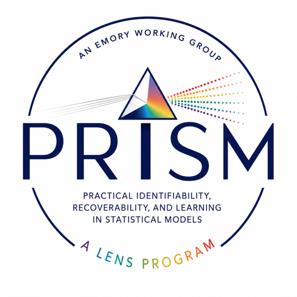

# PRISM Working Group

**Practical Identifiability, Recoverability, and Learning in Statistical Models**

The Emory-based working group of the [LENS Program](https://github.com/lens-program/lens-program)
— *Learning, Estimation, and Nonidentifiability in Statistics*.

## Next meeting

**PRISM Working Group — Tuesday, October 13, 2026, 2:00–3:00 pm Eastern**

**Location:** GCR 311

PRISM meets every Tuesday, 2:00–3:00 pm Eastern, in GCR 311 — except the first Tuesday of the
month, when we join the larger LENS Monthly Group instead.

## What this group is

PRISM is the hands-on half of LENS. Where the **LENS Monthly Group** is a cross-institutional
forum for short talks and works-in-progress, PRISM is a weekly working group of students,
postdocs, and faculty at Emory that does the technical work in depth:

- Deep dives into technical problems
- Method development and analysis
- Code sharing and collaboration
- Preparing work to share with the monthly LENS group

Meetings are weekly, on campus or via Zoom.

## The questions we work on

The program's central question is what can be learned from the available data and models even
when full identification is impossible. In practice that means working on:

- Which parameters or functionals remain recoverable when a full model is nonidentifiable
- How recoverability can be characterised or diagnosed
- How priors, constraints, measurement error, and external information change what is learnable
- How spatial and hierarchical structure affects identifiability
- How to represent uncertainty when information varies across model components

Application areas: small-area estimation, spatial and spatiotemporal models, measurement error
and misclassification, data integration and fusion, hierarchical and multilevel modeling, and
generalized Bayesian and objective-function approaches.

## How we use this repository

**You do not need to know git.** Weekly notes can be added straight from the browser: go to
`meetings/`, use **Add file → Create new file**, name it `YYYY-MM-DD.md`, write in Markdown, and
commit. Cloning is only worth it if you are working on code.

| path | what it holds |
|---|---|
| `meetings/` | Weekly agendas and notes, named `YYYY-MM-DD.md` |
| `code/` | Prototypes, scratch analyses, worked examples |
| `docs/` | Shared materials |

**Issues are the running agenda.** Anything you want to work on or ask about between meetings —
[open an issue](../../issues). Assign it to whoever is looking at it. This is more reliable than
remembering what was agreed last week.

**Code graduates.** Prototypes live here. When something becomes a method implementation, a
package, or a paper's reproduction materials, it moves to its own **public** repository in the
[lens-program](https://github.com/lens-program) organization and gets linked from the
[LENS front page](https://github.com/lens-program/lens-program). Nothing that is ready to share
should stay buried in a private working repo.

**Open-ended discussion belongs upstairs.** Questions worth putting to the wider cross-institutional
group go in [LENS Discussions](https://github.com/lens-program/lens-program/discussions) rather
than here, so people outside Emory can see and answer them.

## Working here

See [CONTRIBUTING.md](CONTRIBUTING.md). Two things worth knowing up front:

**This repository is private.** It is the working space — drafts, half-finished ideas, and
analyses in progress belong here. Work that is ready to share moves to a public repository in
the [lens-program](https://github.com/lens-program) organization.

**Be careful with data.** Members may work with data governed by data-use agreements, ethics
approvals, or other restrictions. Private is not the same as permitted: do not commit data you do
not have the right to share, even here.

## Contact

- **Emily N. Peterson, PhD**, Emory University — emily.nancy.peterson@emory.edu
- **Lance Waller, PhD**, Emory University — lwaller@emory.edu
