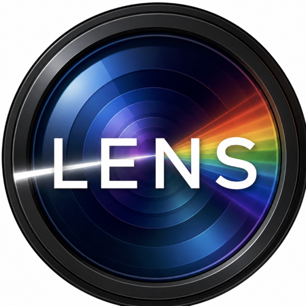

# PRISM Working Group

The Emory-based working group of the [LENS Program](https://github.com/lens-program/lens-program)
— *Learning, Estimation, and Nonidentifiability in Statistics*.

## What this group is

PRISM is the hands-on half of LENS. Where the **LENS Monthly Group** is a cross-institutional
forum for short talks and works-in-progress, PRISM is a weekly working group of students,
postdocs, and faculty at Emory that does the technical work in depth:

- Deep dives into technical problems
- Method development and analysis
- Code sharing and collaboration
- Preparing work to share with the monthly LENS group

Meetings are weekly, on campus or via Zoom.

## The questions we work on

The program's central question is what can be learned from the available data and models even
when full identification is impossible. In practice that means working on:

- Which parameters or functionals remain recoverable when a full model is nonidentifiable
- How recoverability can be characterised or diagnosed
- How priors, constraints, measurement error, and external information change what is learnable
- How spatial and hierarchical structure affects identifiability
- How to represent uncertainty when information varies across model components

Application areas: small-area estimation, spatial and spatiotemporal models, measurement error
and misclassification, data integration and fusion, hierarchical and multilevel modeling, and
generalized Bayesian and objective-function approaches.

## Repository contents

| path | what it holds |
|---|---|
| `meetings/` | Weekly agendas and notes, named `YYYY-MM-DD.md` |
| `code/` | Working code, prototypes, and worked examples |
| `docs/` | Shared materials |

## Working here

See [CONTRIBUTING.md](CONTRIBUTING.md). Two things worth knowing up front:

**This repository is private.** It is the working space — drafts, half-finished ideas, and
analyses in progress belong here. Work that is ready to share moves to a public repository in
the [lens-program](https://github.com/lens-program) organization.

**Be careful with data.** Members work with Tribal, clinical, and restricted surveillance data
governed by data-use agreements. Private is not the same as permitted: do not commit data you do
not have the right to share, even here.

## Contact

- **Emily N. Peterson, PhD**, Emory University — emily.nancy.peterson@emory.edu
- **Lance Waller, PhD**, Emory University — lwaller@emory.edu
